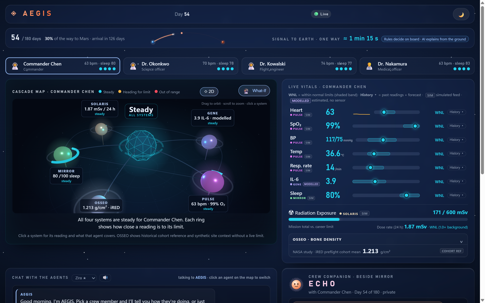
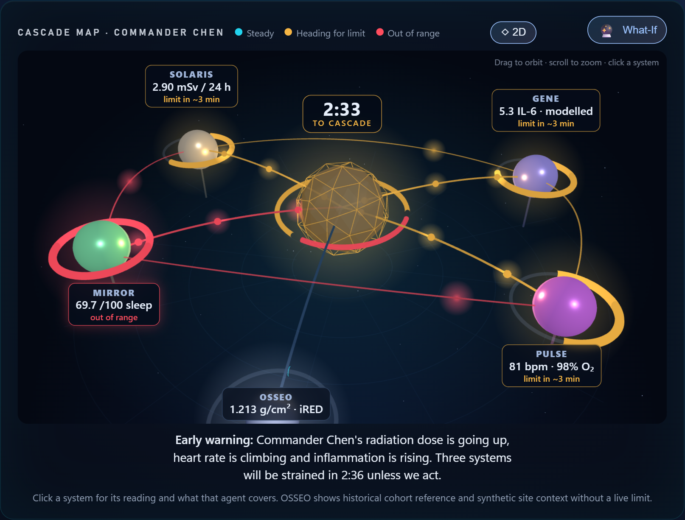
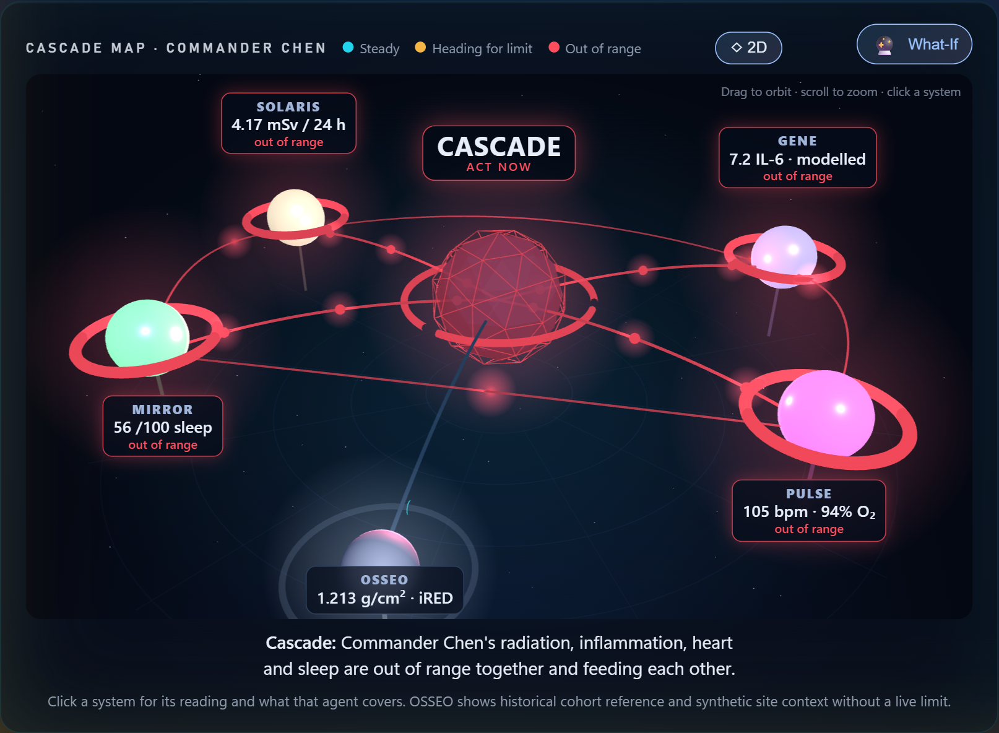

# AEGIS: health monitoring for astronauts on deep-space missions

**Project Horizons · 2026 NASA Space Apps Challenge**
**Challenge: Create Health Monitoring Software for Astronauts on Space Missions**

**Live demo: https://13-219-198-186.sslip.io/** (press **Shift + P** on the dashboard to play the 2-minute story)

> This repository is the **submission copy** for the judges: a frozen snapshot of the project at the build that is live
> on the demo server (working-repo commit `9f5fd94`). Development continues in the team's working repository:
> https://github.com/kuriangeorgebinu/project-horizons-AEGIS-nasa-apps-challeng

> **Prototype, not a medical device.** No wearable hardware is connected: live readings are simulated from published
> ranges and labelled as simulation, and nothing here is clinically validated.

---

## What AEGIS is

On a Mars mission, help from Earth is minutes away: the one-way signal delay grows from about a minute to over twenty.
The crew cannot wait for mission control to notice that something is going wrong.

AEGIS is health-monitoring software that runs **on board**. A team of specialist agents each watches one part of a
crew member's health. AEGIS combines what they see to:

1. **Predict** a health cascade (several body systems drifting out of range together) *before* it happens, with a
   live countdown;
2. **Prevent** it with an early, approved countermeasure plan;
3. **Protect** the crew with emergency protocols when something cannot be prevented, such as a solar storm;
4. **Look after the person**, not just the readings: ECHO, a crew companion, checks in after an emergency.

### The 3D Cascade Map, captured from the live demo



*Mission control on day 54 of a Mars transit: the 3D Cascade Map (the agents orbiting AEGIS) beside Live Vitals.*

| Early warning: AEGIS forecasts the cascade, 2:33 before it forms | The cascade fires: every system out of range together |
|---|---|
|  |  |

*Real captures of https://13-219-198-186.sslip.io/ in 3D mode (the map can be switched to 2D). The readings in these
screenshots are **simulated** from published NASA ranges and labelled **SIM** / **MODELLED** on the dashboard; no
wearable hardware is connected.*

---

## The agents

| Agent | Looks after | What it does |
|---|---|---|
| **SOLARIS** | Radiation | Daily and mission-total dose against the mission's normal background. ≥ 2× background = elevated; ≥ 5× background (and ≥ background + 5 mSv) = storm shelter (SHELTER-1). |
| **GENE** | Inflammation (IL-6) | IL-6 against each crew member's **own pre-flight baseline** (≥ 1.5× baseline and +1.5 pg/mL, or > 12 pg/mL). IL-6 is **modelled** from stress and radiation, because no in-flight blood sensor exists. |
| **PULSE** | Vitals | Heart rate and blood oxygen (SpO₂) raise alerts (fast or slow heart rate, low oxygen → MEDIC-1). Blood pressure, temperature and respiration are monitored against their normal ranges. |
| **MIRROR** | Sleep and mental health | Sleep quality and stress; poor sleep is an early sign that feeds the cascade forecast and wakes ECHO. |
| **ECHO** | Isolation and wellbeing | A crew companion, not a monitor: a private chat that checks in after an emergency or a bad night. It escalates to the crew medical officer first, then the flight surgeon. It always says it is an AI and not a counsellor. |
| **OSSEO** | Bone density | Context only: NASA study averages for bone loss in space, plus clearly labelled synthetic scans. It never raises an alert on its own. |
| **AEGIS** | The whole picture | Combines the specialists for each crew member, forecasts the cascade, chooses the protocol and coordinates the response. |

---

## How it works

### Cascade forecasting and prevention

- Every reading has a limit owned by one agent. A **least-squares trend** over the last few minutes forecasts when each
  reading will cross its limit (`aegis_trends.py`).
- When **three systems** are forecast to be out of range together, AEGIS raises an **early cascade warning** with a
  countdown in the centre of the Cascade Map, and offers **PREVENT-1**, a prevention plan the crew can start at once.
- If nobody acts, the cascade fires: the person's whole monitored set goes out of range together, AEGIS raises the
  cascade alert and recommends **RECOVER-3**.
- **Scope:** the demo compresses a cascade into minutes; on a real mission the same method would run on
  hours-to-days of data, and that is not yet validated.

### The demo flow (2 minutes, Shift + P)

1. **Predict.** Day 54 of a Mars transit. Commander Chen's radiation dose creeps up, and her sleep and inflammation
   follow. AEGIS forecasts a cascade before it happens and starts the countdown.
2. **Prevent.** The crew accepts the prevention plan; the rings come back down and the cascade is avoided.
3. **Protect.** A solar storm hits the whole crew. SOLARIS orders the storm shelter (SHELTER-1) and AEGIS phones the
   flight surgeon (logged, not dialled, in the demo). The alert stays open until the doses are safe again.
4. **ECHO check-in.** With the storm over, ECHO checks on the Commander as a person.
5. **Cited recommendations.** Throughout, the Status card lists recommended actions approved by the rules and backed
   by cited NASA sources. The crew can **Accept** or **Defer** each one.

Other scenarios on the dashboard: **Shift + D** cascade (left alone it fires), **Shift + B** slow build-up,
**Shift + M** medical emergency (low oxygen), **Shift + S** solar storm, **Shift + N** back to normal,
**Shift + R** clean reset.

### What judges will see on the dashboard

- **Cascade Map** (3D by default, 2D on request): the agents around AEGIS, each ring filling as its reading nears its
  limit, with the cascade countdown in the centre.
- **Live Vitals**: heart rate, SpO₂, blood pressure, temperature, respiration, IL-6, sleep and radiation, each tagged
  **SIM** (simulated feed) or **MODELLED** (estimated), with the normal range shaded.
- **Status and recommendations**: the live alert with its one-click protocol, the early warning, and the cited
  recommendations with Accept / Defer.
- **Chat with the agents** and **ECHO** side by side; the agents answer from the same live readings as the panel.
- **Evidence & data**: the datasets behind the numbers, with source links and how each rule was tested against them.

---

## Data sources and honesty notes

| What | Source | How AEGIS uses it |
|---|---|---|
| IL-6 baselines | NASA Open Science Data Repository, **Inspiration4** crew blood data (**OSD-575**). Real pre-flight range **2.5–5.9 pg/mL** | Each crew member's pre-flight IL-6 baseline is seeded inside this real range; GENE alerts on rises above that personal baseline |
| Radiation background | **Curiosity RAD**, measured on the cruise to Mars: **1.84 mSv/day** | The Mars-transit normal background; SOLARIS warns at 2× and orders the shelter at 5× (and background + 5 mSv) |
| Dose limits | **NASA-STD-3001**: 600 mSv career limit; 30-day limit of 250 mGy-Eq to the blood-forming organs | Mission-total and 30-day limits shown and checked by SOLARIS |
| Other risks and countermeasures | NASA Human Research Program roadmap and technical reports (cited in `data/AEGIS_SOURCES.md`) | The knowledge base behind the cited recommendations |

**Honesty notes**

- **Live readings are simulated**, generated from the published ranges above and labelled **SIM** on the dashboard.
  A wearable or dosimeter would supply them on a real mission. IL-6 is labelled **MODELLED**.
- **The protocols SHELTER-1, PREVENT-1, RECOVER-3 and MEDIC-1 are written by the AEGIS team.** They are not NASA
  protocols, although each step cites the NASA sources it draws on.
- **Bone density (OSSEO)** uses study averages plus **labelled synthetic scans**, not real crew data.
- The accuracy evaluation (`eval/`, `artifacts/AEGIS-Accuracy-Report.html`) replays real Inspiration4 IL-6 values,
  measured ISS and Mars radiation and clinical cut-offs through the rules. The GENE rule was tuned on the same
  Inspiration4 data, so that result is a consistency check, not an independent test.

### Generative AI disclosure

**Rule-based agents make every decision**: when to alert, which protocol to choose and which actions are approved.
A **cloud AI service only words the chat answers** and the explanation text. Every AI answer is **fact-checked
against the live readings** (numbers, units, citations, approved actions, no invented medicines) by `aegis_verify.py`.
If the check fails or the service is unavailable, AEGIS shows the **rule-based answer instead**. Crew names are never
sent to the AI service. Everything works without an AI key, with rule-based answers only.

---

## Run it locally

**Prerequisites:** Python 3.10+ (3.13 used in development). An AI key and phone-alarm settings are optional.

```powershell
# 1. Install
cd aegis-nasa-space-apps-2026
python -m venv .venv
.venv\Scripts\activate          # macOS/Linux: source .venv/bin/activate
pip install -r requirements.txt

# 2. Configure (optional: everything works without keys, using rule-based answers)
copy .env.example .env          # macOS/Linux: cp .env.example .env

# 3. Start the backend (API on port 8000; the first start builds the knowledge base, about 20-60 s)
$env:PYTHONUTF8 = "1"           # Windows only: the startup log prints emoji
uvicorn main:app --host 127.0.0.1 --port 8000

# 4. In a second terminal, from the project folder, serve the dashboard
python -m http.server 8080 --bind 127.0.0.1
```

Open **http://127.0.0.1:8080/aegis-mission-control.html**. The header shows **🟢 Live** when the backend is
connected. Click once on the page so the browser allows the agents' voices, then press **Shift + P** for the demo.
Phone calls are off by default: without phone settings, calls are logged as "would have called", never dialled.

API docs: http://127.0.0.1:8000/docs

---

## Tech stack

- **Backend:** Python, FastAPI, Uvicorn, Pydantic, SQLite
- **Agents and forecasting:** rule-based agents (`agents.py`), least-squares trend forecasting (`aegis_trends.py`),
  mission profiles (`aegis_mission.py`), fact checker for AI output (`aegis_verify.py`)
- **Knowledge base:** ChromaDB with sentence-transformers (all-MiniLM-L6-v2) over NASA sources, for the cited
  recommendations
- **AI wording (optional):** a cloud AI service called over HTTPS, with a rule-based fallback
- **Dashboard:** plain HTML, CSS and JavaScript (no framework); three.js for the 3D Cascade Map; browser speech or
  Amazon Polly voices
- **Phone alarm (optional):** Twilio voice calls to the on-call flight surgeon
- **Cloud and CI/CD:** AWS Lightsail, Terraform, GitHub Actions (OIDC, no stored AWS keys), Caddy (HTTPS)
- **Monitoring:** Prometheus and Grafana

### CI/CD

`.github/workflows/aws-lightsail.yml` is the same one-button workflow as the working repository:
**Actions → "AEGIS on AWS (Lightsail)" → Run workflow →** `deploy` (Terraform + deploy), `app-only` (redeploy the
code) or `destroy` (delete the server). It only runs when started by hand, and it needs the repository's AWS role,
variables and secrets to be configured. The live demo is deployed from the working repository.

---

## Project structure

```
├── main.py                      # FastAPI backend (routes under /api)
├── agents.py                    # SOLARIS, GENE, PULSE, MIRROR + the AEGIS coordinator
├── aegis_echo.py                # ECHO crew companion
├── aegis_osseo.py               # OSSEO bone-density context
├── aegis_trends.py              # PREDICT: trends, forecasts, predicted cascade
├── aegis_mission.py             # Mission profiles, radiation background and limits, IL-6 model
├── aegis_llm.py                 # Optional AI wording layer and agent personas
├── aegis_verify.py              # Fact checker for AI output
├── aegis_rag.py                 # Knowledge-base retrieval (ChromaDB)
├── aegis_notify.py              # Phone alarm (Twilio)
├── simulator.py                 # Simulated vitals and demo scenarios
├── database.py, models.py       # SQLite storage and data models
├── aegis-mission-control.html   # The dashboard (with css/ and js/)
├── aegis-api-client.js          # Dashboard ↔ backend client
├── aegis-spacecraft-sim-2d.html # 2D spacecraft: protocols carried out on board
├── data/                        # Knowledge base, NASA risks, cited sources, Inspiration4 data
├── eval/                        # Accuracy evaluation
├── artifacts/                   # Reports: accuracy, architecture, test plan, solution brief
├── docs/                        # Screenshots and test scenarios
├── infra/terraform/, deploy/    # AWS infrastructure, deploy script, monitoring
└── .github/workflows/           # CI/CD
```

---

## Team: Project Horizons

- **Kurian George Binu**
- **Leo Tan**
- **Muhammad Abdullah Nazeer**
- **Midhat Maryam**

**All four team members contributed to the project.** This submission copy was published to GitHub by one team
member on the team's behalf, so the repository owner and commit author do not reflect who did the work.

## License

NASA Space Apps Challenge 2026 · open source.
